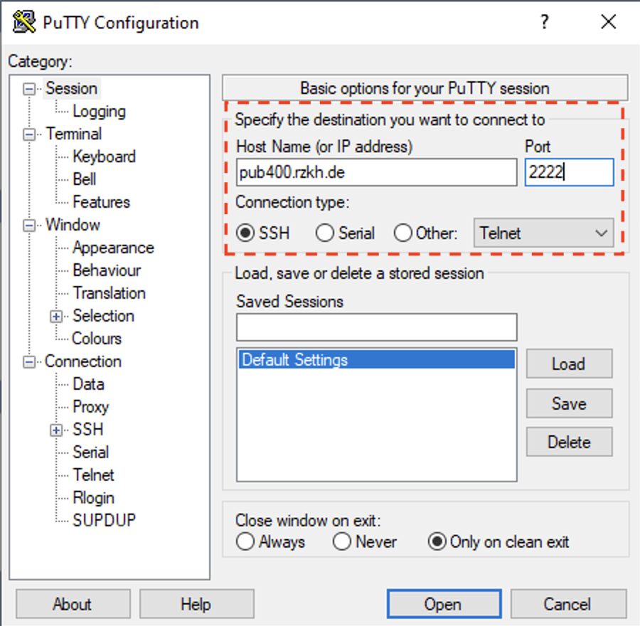
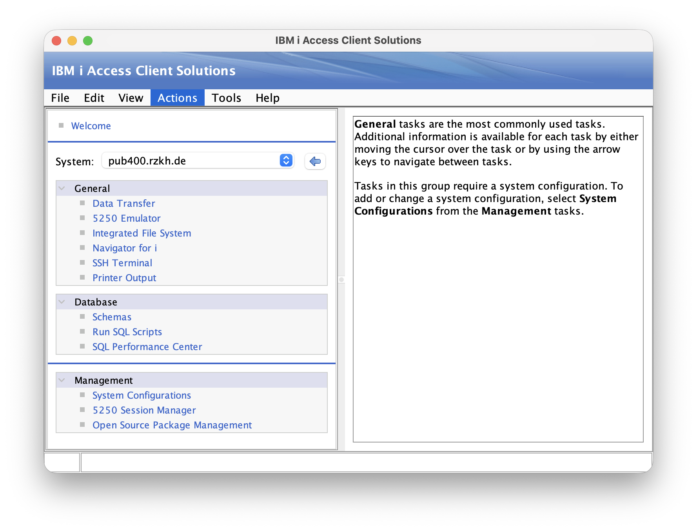
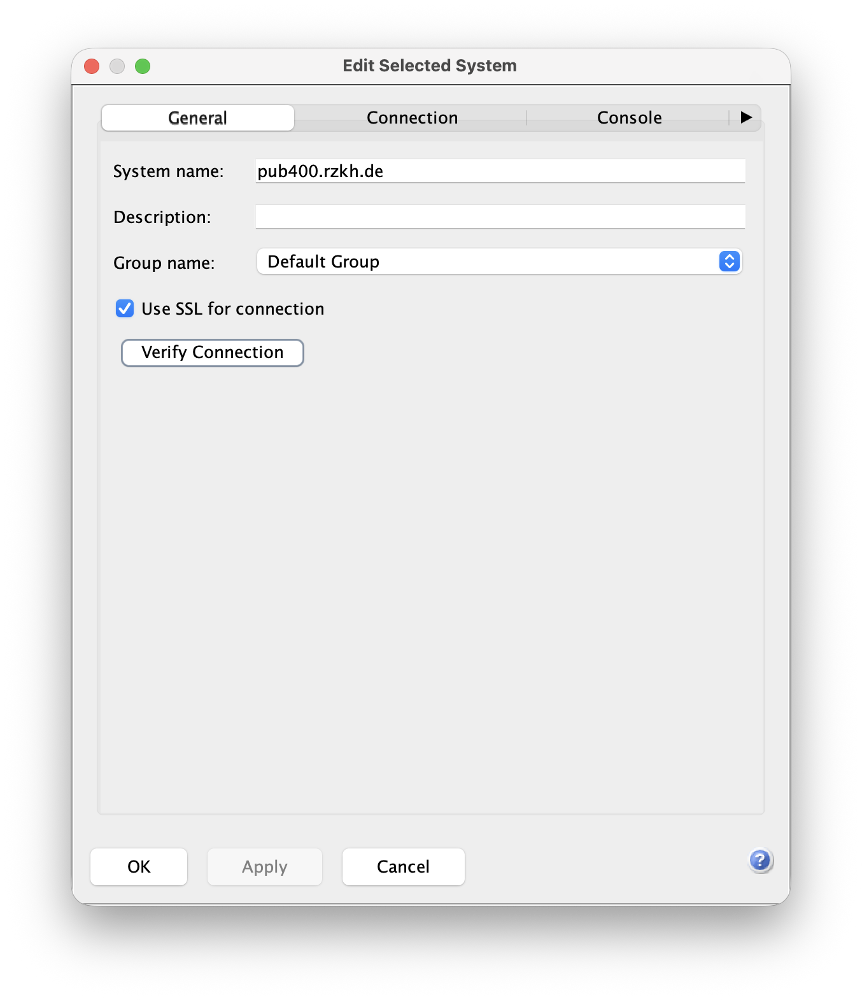
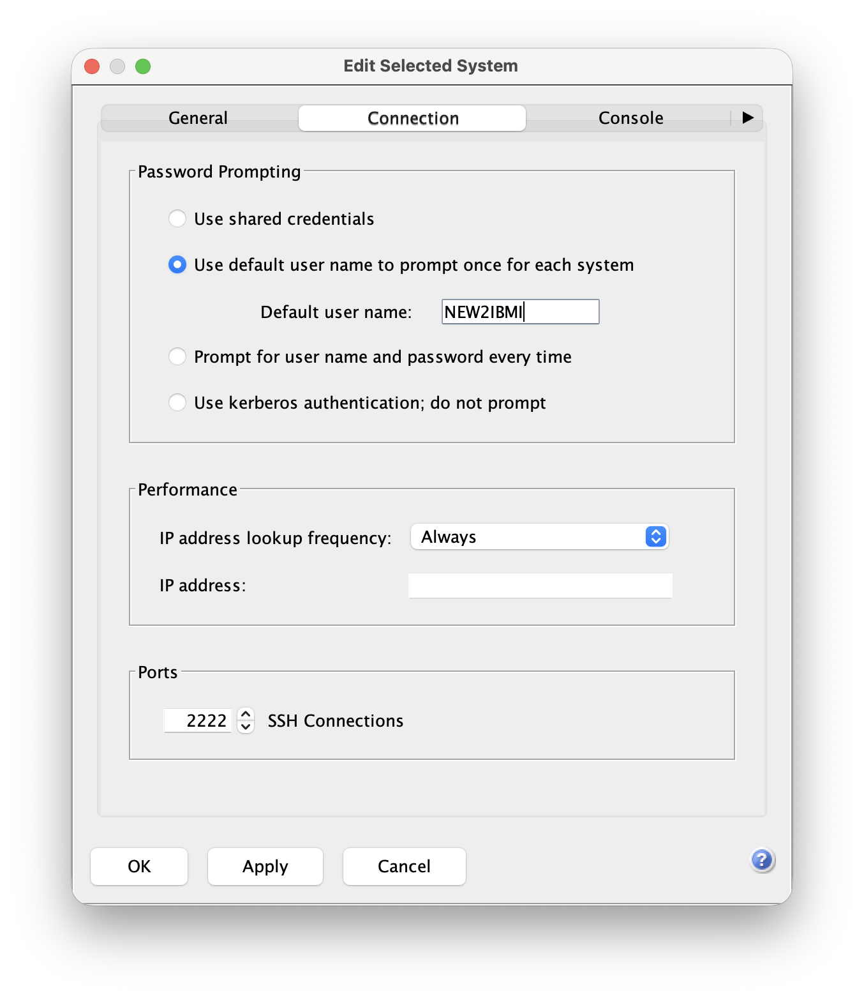
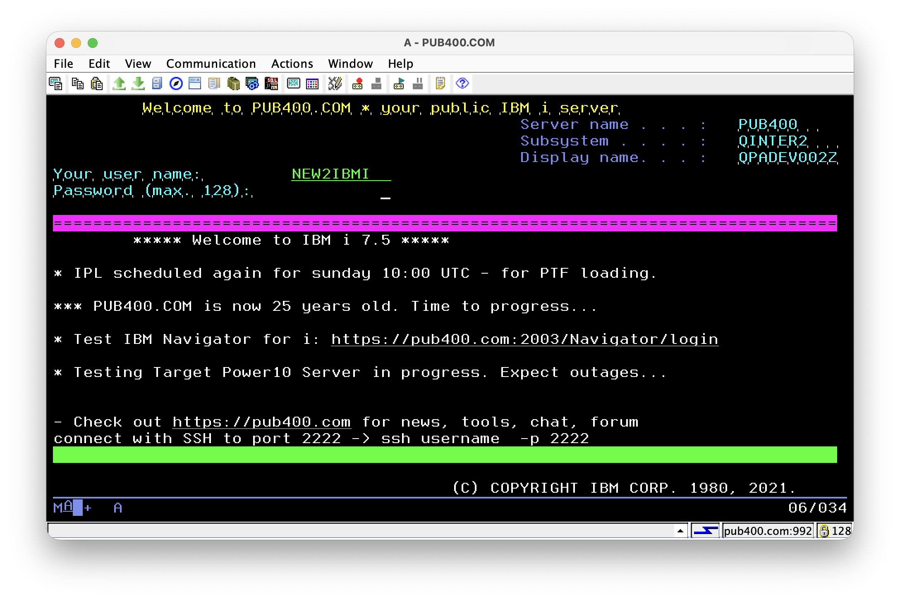
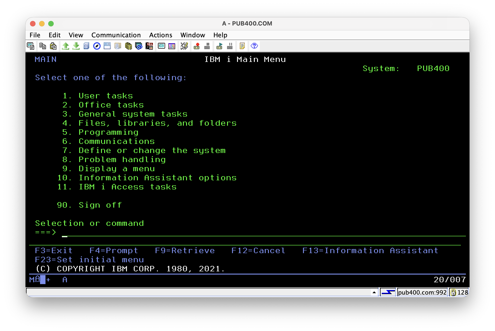

## New to IBM i and RPG? - Where do I even start?

If you are new to IBM i and RPG, it can be a bit overwhelming to know where to start. But don't worry, this guide will help you get started with the basics.

### Getting Started with IBM i

One of the best tutorials to get started with IBM i is Rainier Letidjawa's tutorial on "What is IBM i?" This tutorial provides a comprehensive overview of the IBM i platform, its architecture, and its capabilities.

- [https://rainierio.dev/learn](https://rainierio.dev/learn)

### Getting free access to an IBM i system

If you don't have access to an IBM i at work, you can get free access to an IBM i system by signing up at PUB400 - an IBM i system that is suppplied Holger Scherer of www.POWERbunker.com. It's  available for public use.

- [https://www.pub400.com/](https://www.pub400.com/)

After signing up, you will receive an email with your login credentials. For the rest of this tutorial, we will assume your credentials are:

   - Username: `NEW2IBMI`
   - Password: `ourSecret`   

But before you can use the system, you need to know, that system level access (aka *command line*) an IBM i system can be done by 2 fairly different ways:

1. Using SSH (Secure Shell) to connect to the system and access the command line. 

   If you use windows, you need a SSH client like [PuTTY](https://www.chiark.greenend.org.uk/%7Esgtatham/putty/) installed on your computer. 

   - [https://www.chiark.greenend.org.uk/%7Esgtatham/putty](https://www.chiark.greenend.org.uk/%7Esgtatham/putty)

   After installing PuTTY, you can connect to the PUB400 system by entering the following information in the PuTTY configuration window:

   

   When using a Mac or Linux, you can use the built-in Terminal application to connect to the system using SSH. The command to connect is:
   ```sh
   ssh -p 2222 NEW2IBMI@pub400.rzkh.de
   ```
  

   Accept the host key and enter your credentials when prompted. You should now be connected to the PUB400 system and see a command prompt.

   ```
   Hostname: pub400.rzkh.de
   Port    : 2222
   Username: <your pub400 username>
   Passwort: <your pub400 password>
   ```

   When using a Mac or Linux, you can use the built-in Terminal application to connect to the system using SSH. The command to connect is:
   ```sh
   % ssh -p 2222 NEW2IBMI@pub400.rzkh.de
   ```
   
   Anyway, the servers fingerprint at this time is:
   ```
   ssh-ed25519 255 SHA256:NcBw63NS/aa3kLgyEzg7TMDqp3H4D1q6CLjJfS/FyaE
   ```
   And you be greeted with the following friendly message:
   ```
   *********************************************
   * WELCOME TO PUB400.COM - your public IBM i *
   * ----------------------------------------- *
   * Please take note of the following:        *
   * - all access is logged                    *
   * - please be polite and do not disturb     *
   *   other users!                            *
   * - this system is of limited support       *
   * - see https://pub400.com                  *
   ********************************************* 
   ```
   You will land on a fairly normal *nix command line prompt, where you can enter commands.
  
   But this is not the typical command line of an IBM i system. 

2. Using a 5250 emulator to connect to the system and access the command line. 

   For this, you first need a 5250 emulator installed on your computer. 
   There are many free and paid options available, but the standard solution is [IBM i Access Client Solutions](https://www.ibm.com/support/pages/ibm-i-access-client-solutions) - or short *iACS*.

   - [https://www.ibm.com/support/pages/ibm-i-access-client-solutions](https://www.ibm.com/support/pages/ibm-i-access-client-solutions)

   You need an IBM ID to download the software. And as IBMi Access Client Solutions is a Java application, you also need to have Java installed on your computer.

   After installing iACS, start it and configure a new system connection to PUB400:

   
   
   
   
   You can test the connection by clicking on the "Verify Connection" button. If the connection is successful, you can save it.

   In the main iACS window, select the PUB400 system and click on "5250 Emulator" to open a 5250 session. Enter your credentials when prompted. You should now be connected to the PUB400 system and see the signon screen.

   

   Enter your credentials again and press Enter.

   
   
   Probably the signon screen was skipped and you landed directly on the main menu. 

   If you want to see, who is logged in and which jobs are running, you can enter the command `WRKACTJOB` (that stands for **W**o**RK**with**ACT**ive**JOB**s) on the command line and press Enter.
   
   When you are finished with looking around, you should gracefully log out of the system. You can do this by entering the command `SIGNOFF` on the command line and pressing Enter.

   We will explore more of the system later.


