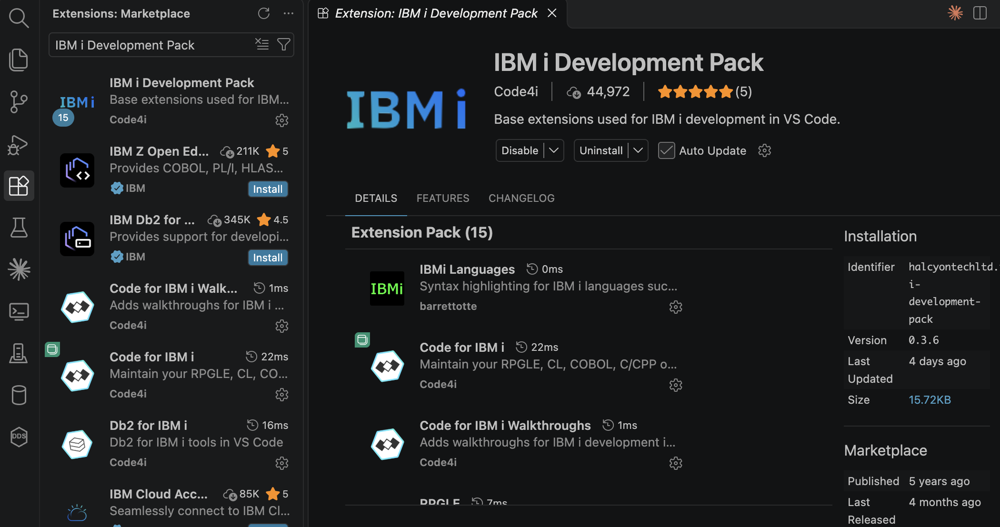
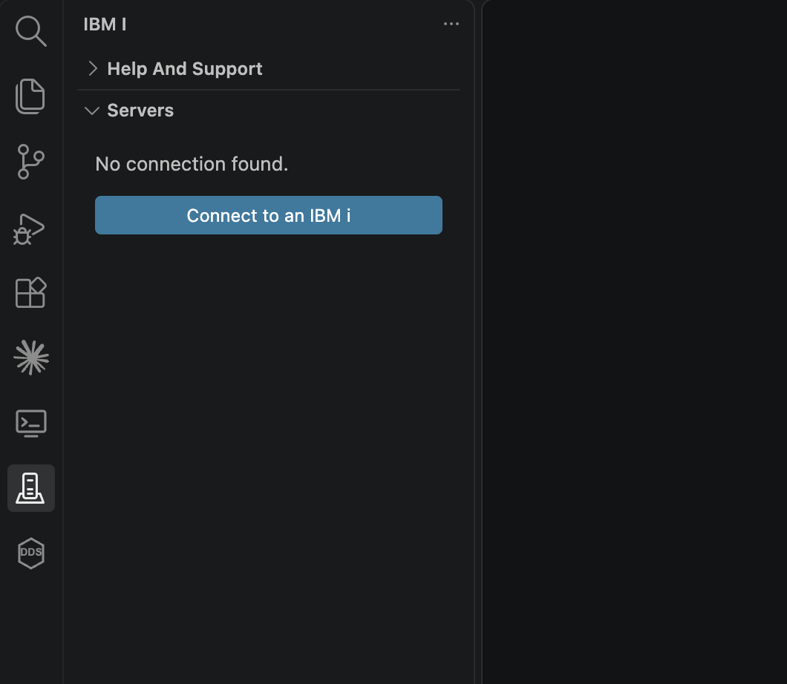
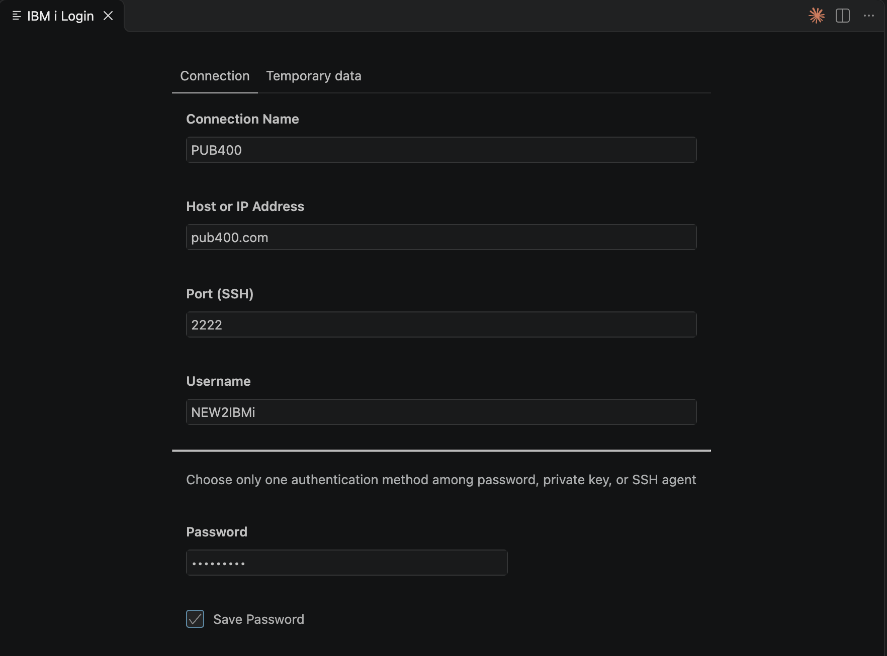
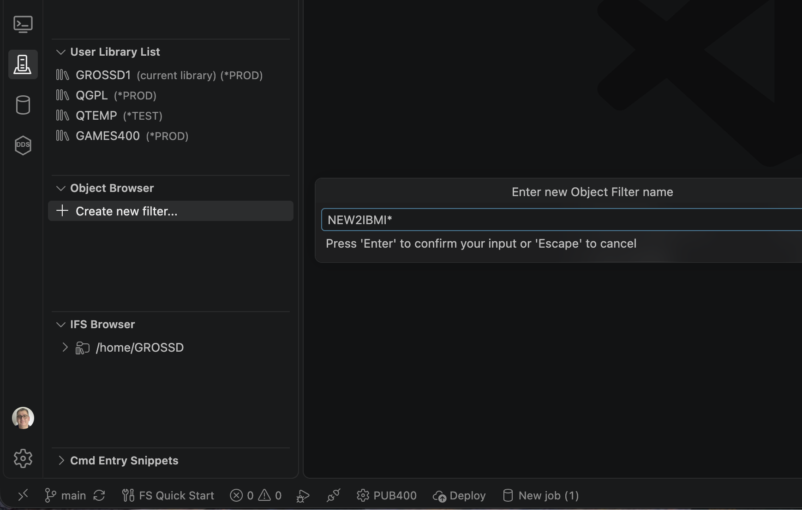
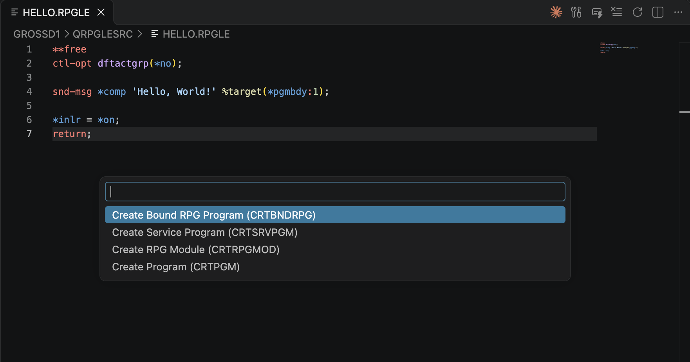
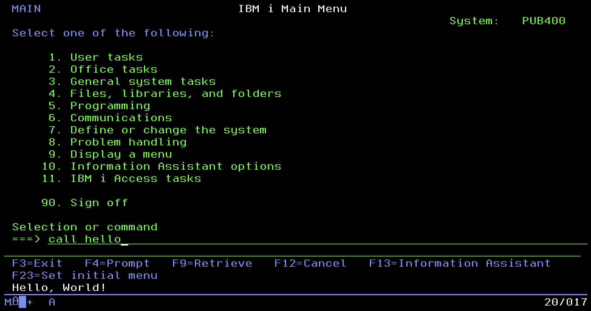

## New to IBM i and RPG? - Let's write some code!

In my [last post]() we got access to PUB400 and had a first look around - via SSH and via the 5250 emulator in iACS. Now it's time to write our first program.

But before we can write code, we need an editor. And this is where things changed a lot over the last years.

### Green screen, RDi, or VS Code?

For decades, IBM i developers wrote their code in **SEU** (the **S**ource **E**ntry **U**tility) - directly in the 5250 green screen. SEU still exists, but it has been stabilized years ago and doesn't understand modern RPG (aka *fully free* RPG). So please don't start with it.

Then came **RDi** (IBM **R**ational **D**eveloper for **i**) - an Eclipse based IDE. It's still a great and powerful tool (see my [99 RDi tips]()), but it is a paid product and you need a license.

Today, the way most new IBM i developers start is **Visual Studio Code** with the free and open source extension **Code for IBM i**. And since this year, there is a second option: **IBM Bob**.

### VS Code vs. IBM Bob

Let's clear up the confusion first, because I'm asked this a lot:

**Visual Studio Code** (or short *VS Code*) is Microsoft's free, general purpose code editor. It runs on Windows, macOS and Linux, and almost everything you need for IBM i development comes in the form of *extensions*, that you install from the VS Code Marketplace.

- [https://code.visualstudio.com](https://code.visualstudio.com)

**IBM Bob** is IBM's AI driven IDE, which became generally available on March 24th, 2026 - and Bob 2.0 followed in June. Under the hood, Bob is built on the same foundation as VS Code. So if you know VS Code, you will feel at home in Bob immediately - the editor, the views, the keyboard shortcuts, and most extensions work the same. The big difference is Bob, the AI agent, built right into the IDE. You can chat with it, let it explain old code, write new code, or refactor existing programs.

- [https://www.ibm.com/products/ai-coding-agent](https://www.ibm.com/products/ai-coding-agent)

For IBM i there is also the **IBM Bob Premium Package for i**, which teaches Bob a lot more about RPG, CL, DDS, Db2 for i and the IBM i itself. But this package is a paid add-on to a Bob subscription (Pro, Pro+ or Ultra) - it is not part of the free trial.

So which one should you use?

| | VS Code | IBM Bob |
|---|---|---|
| Price | free | free trial, then subscription |
| Code for IBM i | yes | yes |
| AI assistant | via extensions (e.g. GitHub Copilot) | Bob is built in |
| IBM i specific AI | no | with the Premium Package for i |
| Extensions from | VS Code Marketplace | Open VSX |
| Supported platforms | Windows, macOS, Linux | Windows, macOS, Linux |

My personal recommendation for a beginner: **start with VS Code**. It's free, it doesn't expire, and everything you learn there works 1:1 in Bob later. When you get to the point where you want an AI pair programmer that knows your IBM i, give Bob a try. I've written about [IBM Bob on macOS]() and [IBM Bob Enterprise subscriptions]() before.

The rest of this post works for both - I'll use VS Code in the screen shots.

### Code for IBM i and the IBM i Development Pack

**Code for IBM i** is the extension that turns VS Code (or Bob) into an IBM i IDE. It was started by Liam Allan, is developed in the open by the community, and since October 2025 you can even buy official IBM support for it. With Code for IBM i you can:

- browse libraries, source files, members and objects on your IBM i
- edit and compile RPGLE, CL, COBOL, C/C++, DDS and more
- browse and edit files in the IFS
- run commands and look at the compile listings and errors right in the editor
- debug your programs

- [https://codefori.github.io/docs/](https://codefori.github.io/docs/)

Code for IBM i alone is good - but you want a few more extensions for things like syntax checking, content assist for RPG, or running SQL. And that's exactly what the **IBM i Development Pack** is: a curated *extension pack*, that installs Code for IBM i together with its useful friends, like:

- **IBM i Languages** - syntax highlighting for RPG, CL, COBOL, DDS
- **RPGLE** - linter and content assist for RPG (go to definition, outline, etc.)
- **Db2 for IBM i** - run SQL statements and browse your schemas
- **IBM i Project Explorer** and **Source Orbit** - for working with local (Git based) projects
- **IBM i Renderer** and the **Code for IBM i Walkthroughs**

The exact content of the pack changes from time to time - just install it and you're good.

#### Installing in VS Code

1. Open the *Extensions* view (`Ctrl+Shift+X` - or `Cmd+Shift+X` on a Mac).
2. Search for **IBM i Development Pack**.
3. Click *Install*.

   

That's it. After a reload you will find a new IBM i icon in the activity bar on the left.

#### Installing in IBM Bob

Bob doesn't use the Microsoft Marketplace, but **Open VSX** - so the search works the same, the source is just different. Search for **IBM i Development Pack** in the Extensions view and install it.

If you have a subscription for the **IBM Bob Premium Package for i**, install that extension instead - it automatically installs Code for IBM i and the other extensions it depends on. You can still add the Development Pack on top.

### Connecting to PUB400

Code for IBM i talks to your IBM i via **SSH** - the same SSH we already used in the [last post](). So if your PuTTY or terminal connection worked, this will work too.

1. Click on the IBM i icon in the activity bar.
2. Click on **Connect to an IBM i** (or the `+` icon at the top of the *Servers* view).

   

3. Fill in the connection details:

   ```
   Connection Name: PUB400
   Host or IP     : pub400.rzkh.de
   Port (SSH)     : 2222
   Username       : NEW2IBMI
   Password       : ourSecret
   ```

   Of course you have created your own credentials on PUB400 - use those instead of the example above.

   Don't forget the port! PUB400 does **not** use the standard SSH port 22, but **2222**.

   

4. Click **Connect**.

The first connect takes a moment, as Code for IBM i checks the system and installs some small helper components in your home directory. You might get some notifications - e.g. about your default shell - which you can ignore for now.

When you are connected, you see the name of your connection in the status bar at the bottom, and the *Object Browser*, *IFS Browser* and *User Library List* views on the left are filled with life.



#### Your library on PUB400

On PUB400 every user gets their own library - named after the user profile with a `1` at the end. So `NEW2IBMI` owns the library `NEW2IBMI1`. This is our playground, and it is also our *current library*.

In the *Object Browser* click on **Create new filter** and enter your library `NEW2IBMI1` - now you can browse its content.

### Our first RPG program

Source code on IBM i traditionally lives in *source physical files* - you can think of them as folders - and each program is a *member* in that file. Let's create one for our RPG sources.

Right click on your library in the Object Browser and select **Create Source File** - or simply run this command on the 5250 command line:

```
CRTSRCPF FILE(NEW2IBMI1/QRPGLESRC) RCDLEN(112)
```

Also here - you have your own libraries on PUB400. Our example profile would get 3 libraries:

- `NEW2IBMI1` = first library 
- `NEW2IBMI2` = second library
- `NEW2IBMIB` = backup library

So replace `NEW2IBMI1` with your own library name.

Now right click on `QRPGLESRC` and select **Create Member**. Enter `HELLO.RPGLE` as the name - the extension becomes the *member type*, which tells the system (and VS Code) that this is RPG.

Type the following code:

```rpgle
**free
ctl-opt dftactgrp(*no);

dcl-s message varchar(50);

message = 'Hello IBM i!';
dsply message;

*inlr = *on;
return;
```

Save it with `Ctrl+S` (`Cmd+S`) - the member is saved directly on PUB400.

To compile, press `Ctrl+E` (`Cmd+E`) - this opens the list of *Actions*. Select **Create Bound RPG Program (CRTBNDRPG)**. After a few seconds you should see a notification that the program was created. If not, the errors are shown in the *Problems* view and marked directly in your source.



To run the program, switch to your 5250 session in iACS and enter:

```
CALL HELLO
```

You should see the message `DSPLY  Hello IBM i!` at the bottom of the screen:



Press Enter, and that's it. 

You should see a status message saying `Hello, World!` in the last line of the screen. 

Congratulations, you have written, compiled and run your first RPG program on IBM i!

### What's next?

Now that we have a working development environment, we can dive into RPG itself. In the next post we will have a closer look at the language - variables, data types, loops, and of course how to read data from a database table.

Until then, have a look at the Code for IBM i documentation, which also has a great *Getting Started* section:

- [https://codefori.github.io/docs/](https://codefori.github.io/docs/)
